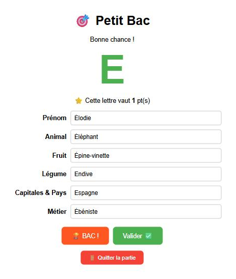
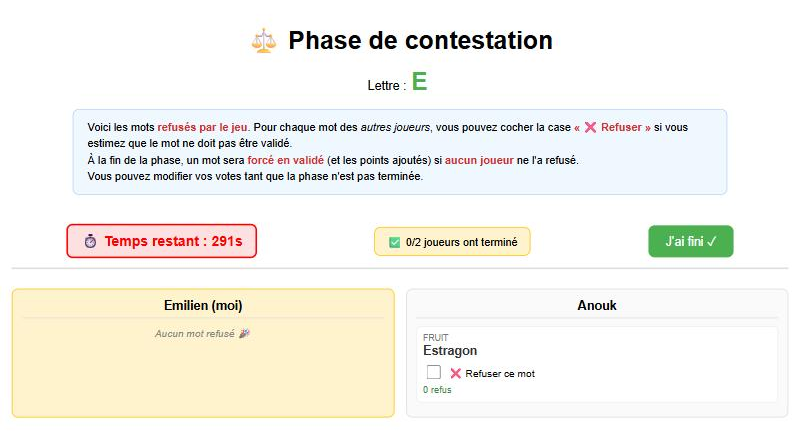
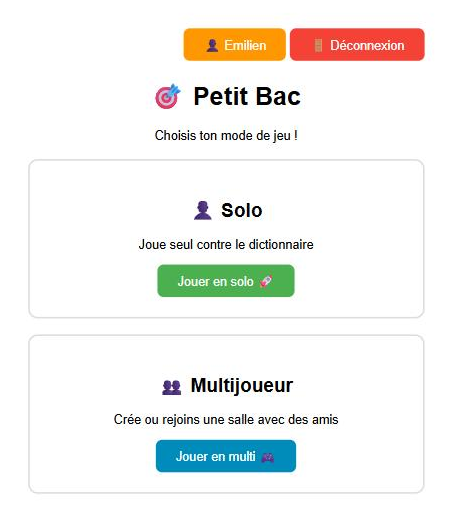
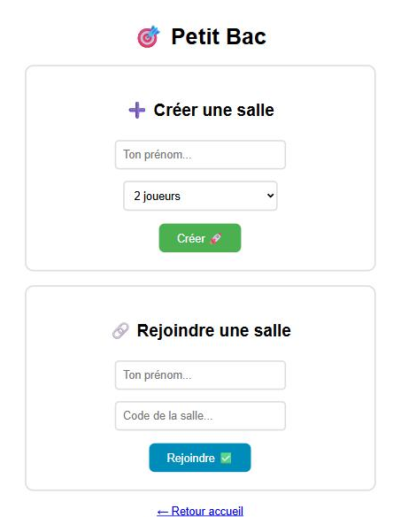
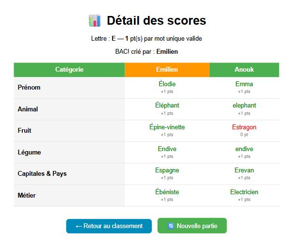
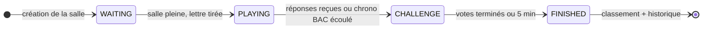
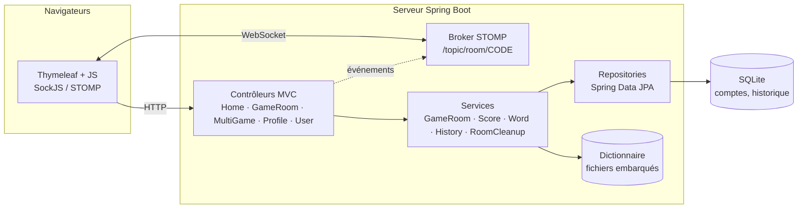

<div align="center">


# Petit Bac — multijoueur en temps réel

**Le jeu du petit bac dans le navigateur : solo contre le dictionnaire ou jusqu'à 4 joueurs en réseau local.**
Salles privées, bouton « BAC ! », vote de contestation des mots, statistiques par joueur.

[](https://github.com/e1000ouch/petit-bac/actions/workflows/ci.yml)
[](https://github.com/e1000ouch/petit-bac/releases/latest)





</div>

---

## Jouer tout de suite

| Plateforme | Téléchargement | Lancement |
|---|---|---|
| **Windows** (recommandé) | [`PetitBac-windows-x64.zip`](https://github.com/e1000ouch/petit-bac/releases/latest) | Décompresser, double-cliquer sur `PetitBac.exe`. Java est inclus, le navigateur s'ouvre tout seul. |
| **Windows / macOS / Linux** | [`petit-bac.jar`](https://github.com/e1000ouch/petit-bac/releases/latest) | `java -jar petit-bac.jar` (Java 21+), puis http://localhost:8080 |

**À plusieurs :** les joueurs connectés au même Wi-Fi ouvrent l'adresse affichée dans la console du serveur (`http://<IP>:8080` ou `http://petitbac.local:8080`), créent un compte et rejoignent la salle avec son code à 6 caractères.

## Fonctionnalités

**Jeu**
- **Solo** : une lettre tirée au hasard, six catégories (prénom, animal, fruit, légume, pays & capitales, métier), validation par le dictionnaire.
- **Multijoueur** de 2 à 4 joueurs dans une salle privée identifiée par un code. Le serveur pousse les événements à tous les navigateurs (arrivée d'un joueur, départ de la partie, cri « BAC ! ») via WebSocket.
- **« BAC ! »** : le premier joueur qui a fini déclenche un compte à rebours de 30 secondes pour les autres. Un mot invalide lui coûte un point de pénalité.
- **Phase de contestation** : les mots refusés par le dictionnaire sont soumis au vote. Un mot que personne ne refuse est validé et rapporte un point.
- **Score** : les lettres rares valent plus (K = 3 points, B = 2…), un mot trouvé par plusieurs joueurs ne rapporte qu'un point.

**Plateforme**
- Comptes utilisateurs (mots de passe hachés en BCrypt, Spring Security), une session active par compte.
- **Profil** avec statistiques : parties, victoires, meilleur score, taux de victoire par lettre et par adversaire, historique.
- Dictionnaire de près de 1 200 mots, tolérant aux accents et à la casse (« elephant » = « Éléphant »).
- Annonce **mDNS** : le serveur est joignable à l'adresse fixe `petitbac.local` sur le réseau local.
- Nettoyage automatique des salles abandonnées, validation de toutes les saisies.

<p align="center">
  
  
  
</p>

## Déroulement d'une partie multijoueur



Chaque transition est diffusée sur le topic STOMP `/topic/room/{code}`. Les navigateurs abonnés changent alors de page tous en même temps.

## Architecture



```
src/main/java/com/petitbac/petitbac_v2/
├── config/        # Spring Security, WebSocket/STOMP, annonce mDNS, bannière de démarrage
├── controller/    # pages solo, salles, partie multijoueur, contestation, profil, comptes
├── model/         # User, GameRoom (état partagé d'une salle), GameHistory, ...
├── repository/    # accès JPA + dictionnaire de mots
└── service/       # règles du jeu : scores, validation, salles, historique, nettoyage
src/main/resources/
├── dictionnaire/  # un fichier par catégorie, un mot par ligne
├── templates/     # vues Thymeleaf
└── static/        # CSS, images
docs/              # rapport technique, maquette, captures
```

Pour le détail de la phase de contestation (concurrence, idempotence, messages STOMP), voir le [rapport technique](docs/rapport-contestation.md).

## Lancer depuis les sources

Prérequis : JDK 21 ou plus. Maven est fourni par le wrapper.

```bash
./mvnw spring-boot:run        # http://localhost:8080
./mvnw verify                 # compilation + tests
./mvnw package                # produit target/petit-bac.jar
```

La base `petitbac-v2.db` est créée au premier lancement, dans le dossier courant.

## Équipe

Projet réalisé dans le cadre d'une **SAE de première année de BUT Informatique** (semestre 2, 2026).

| Membre | Contributions principales |
|---|---|
| **Emilien Brando** | Architecture Spring Boot, multijoueur temps réel, vérification des mots, phase de contestation, mDNS, maquette, refonte du dépôt |
| **Anouk Ober** | Statistiques et profil, protections de connexion, nettoyage des salles, corrections de bugs, interface |

L'historique Git complet du projet est conservé.
